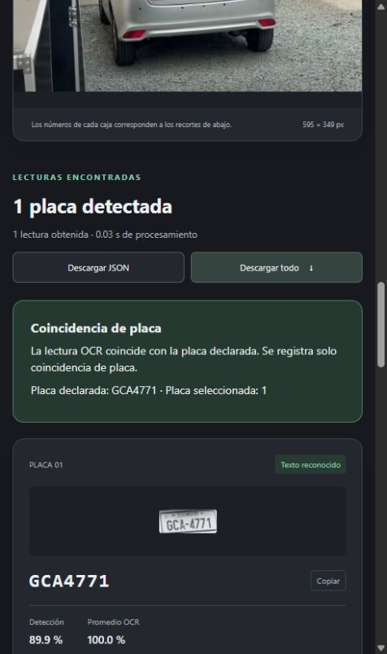

# PlacaLab: detección de placas y OCR


Aplicación web Flask para detectar placas en fotografías, leer sus caracteres
y compararlos con una matrícula declarada. Es una herramienta de apoyo a la
revisión de evidencia vehicular; no aprueba pólizas ni demuestra fraude o identidad.

Repositorio: [DanielGuevara25/Placas_OCR_ProyectoFinal](https://github.com/DanielGuevara25/Placas_OCR_ProyectoFinal).

Estado: versión local verificada, cinco notebooks ejecutados y tres checkpoints
finales disponibles en esta revisión. Siguen pendientes la ampliación experimental
de Semana 5, el despliegue público y los videos.

## Contenido

- [Problema y usuarios](#problema-y-usuarios)
- [Dataset](#dataset)
- [Metodología](#metodología)
- [Resultados disponibles](#resultados-disponibles)
- [Ejecución local](#ejecución-local)
- [Interfaz de usuario](#interfaz-de-usuario)
- [Notebooks](#notebooks)
- [Estructura](#estructura)
- [Entrenamiento y evaluación](#entrenamiento-y-evaluación)
- [Pruebas](#pruebas)
- [Consideraciones éticas](#consideraciones-éticas)
- [Autores y contribuciones](#autores-y-contribuciones)
- [Licencia](#licencia)
- [Agradecimientos y referencias](#agradecimientos-y-referencias)
- [Videos](#videos)
- [Estado de entrega](#estado-de-entrega)

## Problema y usuarios

La inspección de una fotografía vehicular requiere comprobar que la placa visible
corresponda con la declarada. Las placas pequeñas, imágenes difíciles y vehículos
al fondo pueden generar errores. PlacaLab permite revisar cajas, recortes y texto
sin asumir que una lectura automática es siempre correcta.

Se dirige a revisores humanos de evidencia vehicular y a una demostración académica
aplicada a seguros. No se ha medido ahorro de tiempo o coste en producción.

## Dataset

Capturas extraídas del sistema de reconocimiento de placas del lugar de trabajo
del autor. El equipo confirmó autorización para uso académico y publicación;
no se ha indicado una licencia abierta específica ni un enlace público del dataset.
Las imágenes completas no se incluyen en Git; su acceso debe coordinarse con el equipo
bajo las [condiciones de procedencia](data/procedencia.md).

| Partición | Imágenes | Cajas de clase placa |
|---|---:|---:|
| Train | 5.865 | 6.570 |
| Validación | 733 | 819 |
| Test | 734 | 819 |
| Total | 7.332 | 8.208 |

Las etiquetas YOLO contienen clase y centro/ancho/alto normalizados; no son
transcripciones OCR. Se validaron coordenadas y duplicados exactos. No hay
negativos anotados y no se ha descartado dependencia por vehículo o sesión.
El [EDA](docs/analisis_datos.md) aporta estadísticas y seis gráficos.

## Metodología

1. Preparación de etiquetas, revisión registrada y partición por grupos de píxeles
   idénticos con semilla 42, proporción nominal 80/10/10.
2. Entrenamiento YOLOv9t para una clase; comparación de baseline, regularización
   y rotación durante 100 épocas. Selección por mAP50–95 de validación.
3. Inferencia con el detector de regularización, recorte y OCR preentrenado
   `cct-s-v2-global-model`, con reescalado cúbico a 128×64 RGB.
4. Comparación textual sin sustituir O/0 o I/1; selección manual si hay varias placas.
5. Evaluación separada de detección (precisión, recall y mAP), OCR (exactitud
   de matrícula y CER) e integración funcional. No se ajustan parámetros con test.

La [arquitectura](docs/arquitectura.md) contiene el diagrama y las versiones.
La [optimización](docs/optimizacion.md) y el [contraste con Semana 5](docs/semana5_brechas.md)
distinguen los experimentos realizados de Optuna/PDP/interacciones aún pendientes.

## Documentación técnica

- [Planificación y alcance](docs/planificacion.md).
- [Manual de usuario con capturas reales](docs/manual_usuario.md).
- [Arquitectura, modelos y flujo del sistema](docs/arquitectura.md).
- [Consideraciones éticas, privacidad y limitaciones](docs/consideraciones_eticas.md).
- [Análisis de datos](docs/analisis_datos.md).
- [Optimización](docs/optimizacion.md).
- [Pruebas](docs/pruebas.md).

## Estructura

```text
placas_ocr/
├── app/                 # Servidor Flask, HTML, CSS, JavaScript y OCR web
│   ├── app.py
│   ├── templates/
│   ├── static/
│   └── requirements.txt
├── src/                 # Detector, OCR de consola, preparación y experimentos
├── data/                # Datos locales y descripción de su organización
│   ├── raw/
│   ├── processed/
│   ├── annotations/
│   ├── review/
│   └── manifests/
├── models/              # Tres checkpoints finales y manifiesto SHA256
├── notebooks/           # Cinco notebooks ejecutados con evidencia real
├── docs/                # Documentación y registro de migración
├── results/             # Entrenamiento, evaluación y salidas locales
├── tests/               # Pruebas de la web y validación
├── archive/             # Copias históricas locales, excluidas de Git
├── main.py              # Entrada de consola compatible
├── web_app.py           # Entrada web compatible
├── requirements.txt
└── .gitignore
```

El dataset completo, checkpoints por época y copias antiguas están excluidos
de Git. Los tres pesos finales pequeños sí están incluidos y verificados.
Consulta [el mapa de archivos](docs/organizacion.md) para localizar el material anterior.

## Ejecución local

Se requiere Python 3.11 o posterior. El entorno `.venv` recibido apunta a una
instalación de Python ausente; hay que reconstruirlo antes de utilizarlo.
Se verificó un entorno nuevo `.venv-tests/` con Python 3.12.14 en CPU.
`requirements-tested.txt` conserva las versiones que aprobaron las pruebas.

Con un Python funcional, desde la raíz del proyecto:

```powershell
python -m venv .venv
.\.venv\Scripts\python.exe -m pip install -r requirements.txt
.\.venv\Scripts\python.exe web_app.py --device cpu
```

Para obtener el código desde GitHub:

```powershell
git clone https://github.com/DanielGuevara25/Placas_OCR_ProyectoFinal.git
cd Placas_OCR_ProyectoFinal
```

Después se prepara el entorno con los comandos anteriores. Para reproducir
las versiones probadas en Windows/Python 3.12, usar `requirements-tested.txt`
en lugar de `requirements.txt`. Este conjunto de versiones fue probado en Windows
y Python 3.12; todavía no certifica un despliegue Linux. El clon incluye los
tres checkpoints finales. Si faltase uno, ejecutar:

```powershell
python -m src.descargar_modelos --model best
```

La recuperación comprueba tamaño y SHA256 antes de reemplazar el archivo.
Véanse [descargas y manifiesto](models/README.md). El dataset completo sigue
separado; las pruebas unitarias no lo necesitan y usan modelos simulados.

Abre `http://127.0.0.1:8080`. También se puede iniciar con
`python -m app.app --device cpu`.

La web utiliza `models/best.pt` (detector del experimento de regularización)
y `cct-s-v2-global-model` para OCR. El primer uso del OCR puede descargar
sus pesos y requiere Internet. Se puede cambiar el detector con
`--weights "ruta/al/modelo.pt"`. Consulta [models/README.md](models/README.md).

La consola mantiene un recorrido distinto: usa por defecto el detector
preentrenado de `open-image-models`, no el modelo entrenado de la web:

```powershell
python main.py --input "ruta/a/foto.jpg"
```

El servidor local actual no constituye un despliegue público.
El alojamiento web y servidor de producción siguen pendientes de preparar.

## Interfaz de usuario

La página permite declarar una placa, cargar una foto o un ejemplo, ejecutar
inferencia, revisar original/detección, seleccionar entre varias placas,
ver confianzas y descargar JSON, ZIP y recortes. Valida entradas y comunica errores.



Las instrucciones, cinco capturas y soluciones están en el
[manual de usuario](docs/manual_usuario.md). URL pública: pendiente de despliegue;
`127.0.0.1:8080` corresponde únicamente al servidor local.

## Notebooks

| Notebook | Contenido |
|---|---|
| [01_exploracion](notebooks/01_exploracion.ipynb) | Particiones, estadísticas y seis gráficos |
| [02_preprocesamiento](notebooks/02_preprocesamiento.ipynb) | Etiquetas, RGB/BGR y normalización |
| [03_modelado](notebooks/03_modelado.ipynb) | Configuraciones, arquitectura y pesos |
| [04_optimizacion](notebooks/04_optimizacion.ipynb) | Comparación real y pendientes de Semana 5 |
| [05_evaluacion](notebooks/05_evaluacion.ipynb) | Detector, OCR, errores e integración |

Se ejecutaron y conservaron sus salidas, sin iniciar nuevos entrenamientos.
Para repetirlos tras instalar las dependencias principales:

```powershell
python -m pip install -r requirements-notebooks.txt
python tools/ejecutar_notebooks.py
```

Los notebooks funcionan con las evidencias públicas; la validación completa del
dataset o el reentrenamiento requieren los datos y recursos correspondientes.
La existencia de `04_optimizacion` no implica haber completado los 60 ensayos
ni los análisis avanzados de la semana 5.

## Entrenamiento y evaluación

Los scripts se ejecutan como módulos desde la raíz. El entrenamiento requiere
CUDA y el dataset preparado; no se ejecuta al iniciar la web.

```powershell
python -m src.entrenar_placas
python -m src.entrenar_mejoras --experimento regularizacion
python -m src.entrenar_mejoras --experimento rotacion
python -m src.evaluar_curvas --solo-graficas
python -m src.preparar_revision_ocr
python -m src.evaluar_ocr
```

Los YAML/JSON de corridas anteriores conservan rutas históricas como evidencia.
El YAML local `data_entrenamiento.yaml` se actualizó a la nueva ubicación del dataset.
El manifiesto histórico de evaluación de curvas puede impedir reanudar una corrida
cuando detecta cambios de configuración; debe preservarse y compararse antes de regenerar.

## Pruebas

```powershell
python -m unittest discover -s tests -v
```

Se ejecutaron 13 pruebas: diez con modelos simulados para entradas inválidas,
HTML/CSS, selección de placas, exportación ZIP, errores y reutilización de modelos.
Tres verifican integridad y recuperación de pesos sin sobrescribir un destino
con una descarga inválida.
La inferencia real en CPU también se comprobó con tres ejemplos: coincidencia,
inconsistencia y ausencia de placa, todos con el estado esperado.
Consulta [el informe de pruebas](docs/pruebas.md).

## Resultados disponibles

- [Dataset: análisis exploratorio y seis gráficos](docs/analisis_datos.md).
- [Comparación de experimentos y optimización](docs/optimizacion.md).
- [Evaluación del detector](results/evaluation/README.md).
- [Análisis del OCR y limitaciones](results/evaluation/analisis_ocr.md).
- Configuraciones y métricas de los tres experimentos en `results/training/`.
- Curvas train/val y métricas por época en `results/overfitting/`.

Las métricas del detector, OCR y validación completa representan tareas distintas.
La confianza OCR no es una probabilidad calibrada de matrícula correcta.

| Experimento | Mejor mAP50-95 de validación | Época |
|---|---:|---:|
| Baseline | 88,673 % | 80 |
| Regularización | 89,057 % | 82 |
| Rotación | 88,884 % | 89 |

Valores de los registros de entrenamiento; una corrida por configuración.
La regularización mejora 0,384 puntos porcentuales sobre el baseline.
No se han comprobado diferencias estadísticamente significativas.

La evaluación histórica del detector de regularización en test registra precisión
98,6384 %, recall 97,9243 %, mAP50 99,4150 % y mAP50–95 89,3450 %.
El OCR aislado alcanzó 17/22 lecturas exactas (77,27 %) y CER 4,70 % sobre
recortes transcribibles; 32 de los 54 recortes revisados quedaron ilegibles.
No se extrapolan estas cifras al pipeline completo.

## Consideraciones éticas

Se muestran evidencia y límites, sin aprobación automática de pólizas ni
afirmaciones de fraude. La confianza no está calibrada y puede ser alta aun
con una lectura errónea. Los datos de una fuente laboral pueden tener sesgos
de captura y no prueban equidad entre grupos.

Las cargas se procesan en memoria, pero las descargas y los ejemplos sí persisten.
Faltan controles de acceso y validación de producción antes de exponer el servicio.
El [análisis ético](docs/consideraciones_eticas.md) desarrolla los ocho apartados
exigidos y distingue controles implementados de propuestas.

## Autores y contribuciones

| Integrante | Rol Scrum | Contribución |
|---|---|---|
| Daniel Guevara | Scrum Master | Integrante del equipo de desarrollo |
| Christian Guerra | Product Owner | Integrante del equipo de desarrollo |

Ambos conforman el equipo de desarrollo del proyecto. No se ha especificado
una distribución individual de tareas técnicas.

El proyecto comenzó el **22 de septiembre de 2026**. El equipo utilizó
**WhatsApp** como medio de coordinación y contacto. Los números y enlaces
de contacto no se incluyen en este repositorio.

## Estado de entrega

Este README es una base de organización, todavía no la documentación final
exigida por la materia. [Estado de entrega](docs/estado_entrega.md) registra
pendientes de documentación, optimización, licencias y despliegue.

Véase la [auditoría contra la directriz](docs/auditoria_directriz.md).

## Licencia

Los aportes originales del equipo se publican bajo **AGPL-3.0-only**, por
autorización de sus integrantes. Véase [LICENSE](LICENSE).
[Licencias y atribuciones](docs/licencias.md) conserva
los textos originales revisados: Ultralytics declara AGPL-3.0; fast-plate-ocr
y open-image-models declaran MIT. Los datos laborales no reciben automáticamente
la licencia del código.

## Agradecimientos y referencias

Se reconoce a los autores de las bibliotecas y modelos utilizados. El equipo
aporta la integración, experimentos y documentación del proyecto, sin atribuirse
la autoría de los componentes de terceros.

- [Ultralytics: código, modelos y documentación](https://github.com/ultralytics/ultralytics).
- [fast-plate-ocr: OCR preentrenado](https://github.com/ankandrew/fast-plate-ocr).
- [open-image-models: backend alternativo](https://github.com/ankandrew/open-image-models).
- [Flask](https://flask.palletsprojects.com/) y [ONNX Runtime](https://onnxruntime.ai/docs/).
- Directriz del proyecto final y notebook docente de Semana 5 facilitados al equipo;
  sus métodos se distinguen de resultados experimentales efectivamente ejecutados.

## Videos

| Entrega obligatoria | Estado |
|---|---|
| Pitch, máximo 5 minutos, con interfaz real y 2–3 casos | Pendiente de grabación y enlace |
| Respuestas a las preguntas asignadas por el profesor | Pendiente de preguntas, grabación y enlace |

No se incluyen enlaces ficticios ni se marca la entrega como cerrada sin ambos videos.
