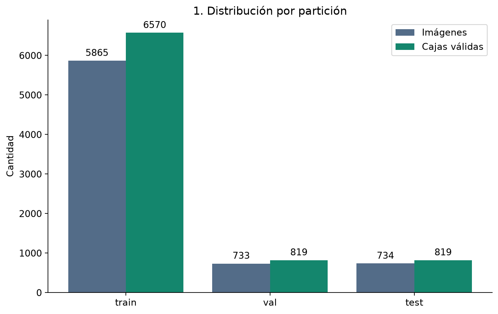
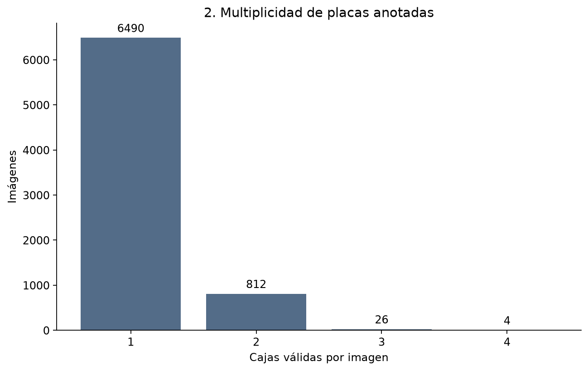
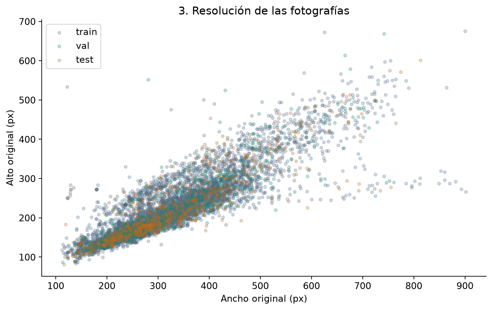
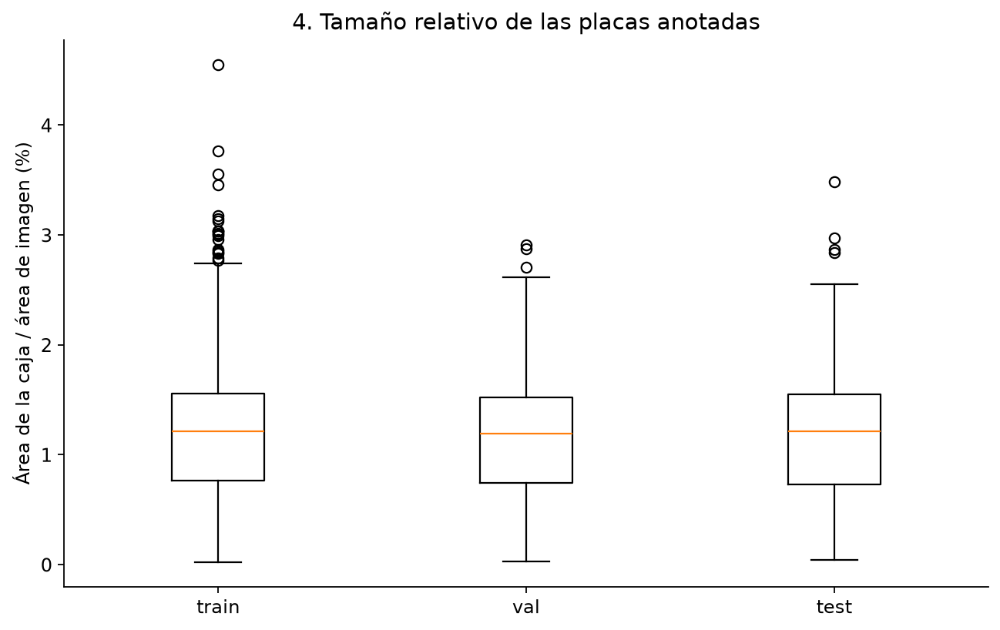
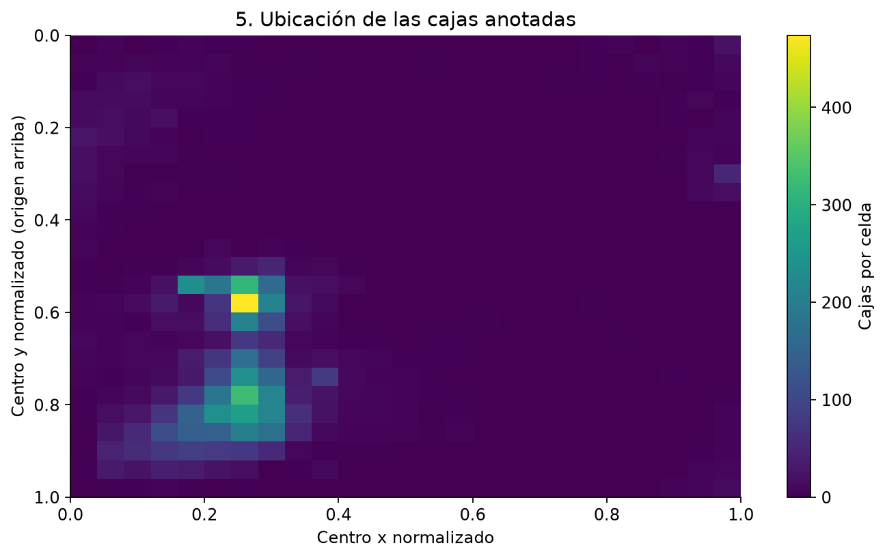
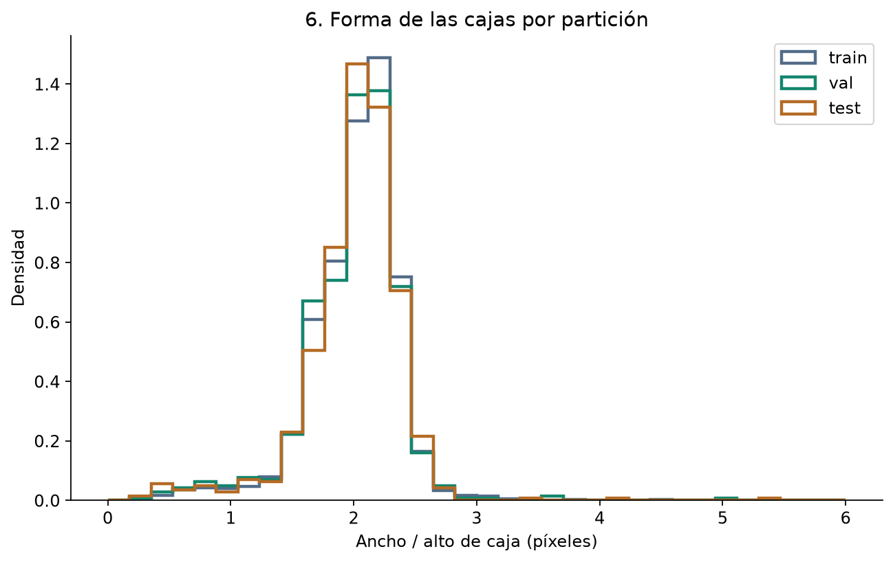

# Análisis exploratorio y auditoría del dataset

## Procedencia, uso y alcance

El dataset contiene fotografías extraídas de un sistema de reconocimiento de
placas empleado en el lugar de trabajo del autor. El autor confirmó autorización
para uso académico y publicación. No se ha aportado una licencia pública
específica ni un enlace de descarga; véase [procedencia](../data/procedencia.md).
La confirmación del autor se distingue de una verificación documental de permisos.

La tarea de aprendizaje es detección de una clase: `0 = placa`. Las etiquetas
YOLO describen cajas mediante centro x, centro y, ancho y alto normalizados.
No constituyen transcripciones de texto OCR ni etiquetas de fraude, identidad,
daños o aprobación de solicitudes de seguros.

Este análisis leyó las imágenes y etiquetas actuales en
`data/processed/dataset_placas/`, los manifiestos y el registro histórico de
anotación. No modificó datos, particiones ni modelos.

## Selección y preparación histórica

El registro `revision.csv` contiene 13.621 entradas: 7.332 marcadas `revisado=SI`
y 6.289 con estado `ERROR_IMAGEN`. Las 7.332 seleccionadas conservan el estado
`CAJAS_POR_REVISAR` junto con la marca `SI`. Esa marca registra una revisión
declarada en el archivo, pero no constituye una auditoría visual independiente
de la exactitud de las cajas.

El código `src/generar_cajas.py` propone etiquetas mediante un detector y genera
vistas para revisión. `src/preparar_dataset.py` selecciona las filas marcadas SI,
comprueba lectura y coordenadas, agrupa por hash de píxeles y divide grupos
con semilla 42 en proporciones nominales 80/10/10.

El archivo `excluidas.csv` está vacío salvo por su encabezado. Esto significa
que no registra rechazos posteriores dentro del conjunto revisado, no que las
13.621 entradas originales fueran válidas: los estados `ERROR_IMAGEN` se omiten
antes de esa etapa. La auditoría actual comprobó las imágenes procesadas,
no diagnosticó individualmente la causa histórica de las 6.289 entradas omitidas.
Esta selección puede introducir sesgo hacia capturas que el proceso anterior
pudo leer y anotar.

## Tamaño y particiones verificadas

| Partición | Imágenes | Cajas válidas | Imágenes con varias cajas | Etiquetas vacías |
|---|---:|---:|---:|---:|
| Entrenamiento | 5.865 | 6.570 | 678 | 0 |
| Validación | 733 | 819 | 84 | 0 |
| Test | 734 | 819 | 80 | 0 |
| Total | 7.332 | 8.208 | 842 | 0 |

La partición efectiva es aproximadamente 80 % / 10 % / 10 %. El número de
imágenes difiere del número de placas porque existen imágenes con varias cajas.
El número de imágenes y cajas de test coincide con el registro de evaluación
previo del detector: 734 y 819, respectivamente.



Todas las imágenes procesadas pudieron decodificarse. No se detectaron etiquetas
faltantes, etiquetas huérfanas, clases distintas de cero, coordenadas no finitas,
cajas fuera del rango normalizado ni discrepancias con los hashes de píxeles
del manifiesto. Se validó el formato y la geometría, no que cada caja represente
visualmente una placa correcta ni que todas las placas de la foto estén anotadas.

## Multiplicidad, faltantes y desbalance

Hay 6.490 imágenes con una caja, 812 con dos, 26 con tres y cuatro con cuatro.
El 11,48 % tiene varias placas anotadas. Esto respalda la necesidad de seleccionar
en la interfaz la placa del vehículo inspeccionado cuando aparecen varias.



Al existir una sola clase de objeto, no hay un balance entre múltiples clases
que pueda evaluarse con estos datos. Sí existe un límite de representación:
no hay etiquetas vacías ni ejemplos anotados como imágenes sin placa en ninguna
partición. No puede suponerse que se haya medido adecuadamente el comportamiento
en fondos negativos. El ejemplo funcional sin placa de la interfaz no sustituye
un conjunto negativo representativo.

No se imputaron etiquetas faltantes ni se convirtieron archivos sin etiqueta
en negativos. Tampoco se añadieron imágenes negativas después de observar test.

## Resolución de las fotografías

| Variable | Mínimo | Mediana | Media | Máximo |
|---|---:|---:|---:|---:|
| Ancho de imagen (px) | 112 | 297 | 325,03 | 902 |
| Alto de imagen (px) | 81 | 202 | 223,79 | 675 |
| Tamaño de archivo (bytes) | 5.381 | 31.744 | 39.869,27 | 220.182 |

Las medianas por eje no describen una imagen individual necesariamente.
La correlación de Pearson entre ancho y alto es 0,874, una asociación descriptiva
entre dimensiones, no evidencia de calidad o legibilidad. Las nubes de puntos
de las tres particiones se superponen visualmente; esto no constituye una prueba
formal de igualdad de distribuciones.



Los experimentos del detector usan `imgsz=640`. Ese tamaño de entrada no implica
que las capturas originales tengan esa resolución ni que el reescalado recupere
detalles ausentes en una placa pequeña.

## Tamaño y localización de las cajas

La mediana de área anotada es 1,210 % del área de imagen. El rango intercuartílico
es 0,759 % a 1,555 % y el rango completo 0,023 % a 4,550 %.
Hay 2.928 cajas (35,67 %) que ocupan menos del 1 % de la fotografía.



El ancho mediano de caja es aproximadamente 38 píxeles y el alto mediano 18.
Hay 2.530 cajas (30,82 %) con alto inferior a 16 píxeles, medido en la imagen
original y con las coordenadas normalizadas disponibles. El umbral de 16 píxeles
es descriptivo, no un umbral de legibilidad validado para este OCR.

Los centros presentan concentraciones en ciertas regiones de la imagen.
Este patrón puede reflejar el encuadre del sistema de origen y limita la
extrapolación a cámaras con composición diferente. No demuestra la causa
concreta del patrón ni independencia entre capturas.



La relación ancho/alto de caja tiene mediana 2,063 y rango intercuartílico
1,839 a 2,235. Existen extremos de aproximadamente 0,227 y 6,000; las
distribuciones por partición son visualmente similares.



Las cajas de dimensiones mínimas cercanas a 3 píxeles y las relaciones extremas
son candidatas a revisión visual. No se eliminaron: un extremo estadístico puede
ser un caso real difícil y no demuestra por sí mismo una etiqueta incorrecta.
Los puntos del boxplot usan la convención de 1,5 rangos intercuartílicos,
sin convertir esa regla gráfica en un criterio automático de limpieza.

## Duplicados e independencia

Se calcularon hashes SHA256 de archivos y de sus píxeles decodificados
con OpenCV, incluyendo la forma de la matriz. No se encontraron grupos de
duplicados exactos en el conjunto procesado ni cruces entre particiones.
Los 7.332 registros del manifiesto coinciden con las imágenes y hashes actuales.

Esto descarta duplicados exactos según esos criterios. No descarta imágenes
casi idénticas, fotogramas consecutivos o capturas del mismo vehículo en
particiones diferentes. No se dispone de una agrupación verificada por vehículo,
sesión o cámara; por tanto, no se declara independencia completa del test.

## Relación con la evaluación OCR

Las cajas pequeñas y la baja resolución son limitaciones plausibles de la
lectura de caracteres. El análisis geométrico actual no midió desenfoque,
iluminación ni legibilidad humana y no demuestra qué factor causó cada error.

La evaluación OCR previa tiene otro alcance: 50 imágenes de test y 54 recortes,
22 transcribibles y 32 marcados ilegibles. Sobre los 22 evaluables se registraron
17 lecturas exactas (77,27 %) y CER 4,70 %. Estas cifras no se atribuyen a las
7.332 imágenes ni se presentan como rendimiento del pipeline completo.

## Implicaciones y trabajo pendiente

- Conservar los fallos y casos difíciles; solicitar otra foto o revisión manual
  cuando no se pueda validar la lectura.
- Construir un conjunto negativo representativo para medir falsas detecciones.
- Auditar visualmente cajas extremas y la completitud de anotaciones.
- Identificar casi duplicados y agrupar por vehículo/sesión si existe metadata
  autorizada, antes de afirmar independencia completa.
- Documentar periodo, cámaras y condiciones de captura para caracterizar sesgos.

Estas acciones son propuestas; no se han ejecutado como parte de esta auditoría
ni se han alterado las particiones que sustentan los resultados históricos.

## Reproducción

```powershell
.\.venv-tests\Scripts\python.exe -m src.analizar_datos
```

Salidas: `results/metrics/analisis_datos.json` y seis figuras en
`results/figures/eda/`. El informe agrega resultados sin publicar nombres de
archivos ni matrículas. El detalle de incidencias se guarda localmente en
`results/reports/dataset_audit_private.json`, excluido de Git. En esta ejecución
no se registraron incidencias de formato, lectura o correspondencia.
