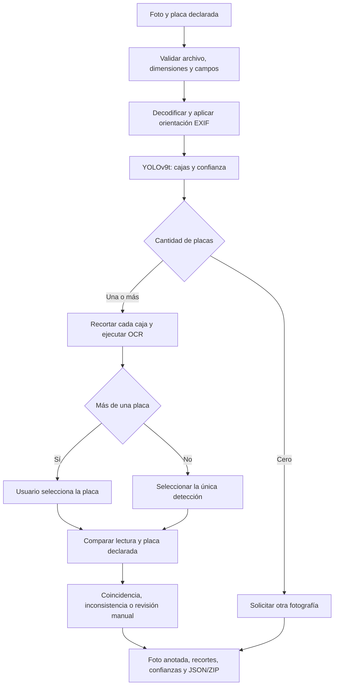

# Arquitectura del sistema PlacaLab

## Propósito y componentes

PlacaLab analiza una fotografía, detecta cajas de placas, reconoce sus caracteres
y compara una placa seleccionada con la matrícula declarada por el usuario.
El sistema combina dos modelos y reglas explícitas. No es un modelo de fraude,
identificación integral del vehículo ni aprobación de pólizas.

| Componente | Implementación | Responsabilidad |
|---|---|---|
| Navegador | `app/templates/index.html`, `app/static/` | Formulario, ejemplos, visualización y descargas |
| Servidor HTTP | `app/app.py` | Validación de solicitudes y endpoints Flask |
| Servicio | `app/web_service.py` | Carga de modelos, detección, recorte y empaquetado |
| Detector | `src/plate_detector.py` | Backend Ultralytics para los pesos entrenados |
| OCR web | `app/web_ocr.py` | Adaptación de fast-plate-ocr y confianzas por carácter |
| Comparación | `app/web_validation.py` | Normalización, selección y estados de validación |
| Configuración | `src/config.py`, `src/paths.py` | Parámetros del modelo y rutas del proyecto |
| Evidencias | `results/` | Métricas, gráficos e informes reproducibles |

La separación facilita probar endpoints con modelos simulados y ejecutar
inferencia real con el mismo servicio. El navegador no carga ni ejecuta los pesos.

## Flujo completo de la aplicación web



1. Se recibe una foto JPEG, PNG, WEBP o BMP y una matrícula declarada.
   La foto debe ser estática, no superar 12 MiB ni 20 millones de píxeles.
   La petición HTTP admite un margen adicional para el formulario multipart.
2. Pillow verifica la lectura, aplica orientación EXIF y convierte a RGB;
   las transparencias se componen sobre fondo blanco.
3. El servicio convierte a BGR contiguo para el detector. Ultralytics realiza
   el preprocesamiento de inferencia con `imgsz=640`, confianza predeterminada
   0,60 e IoU NMS 0,70. El formulario admite confianza entre 0,10 y 0,95.
4. Se conservan cajas finitas de clase cero, se limitan a la fotografía
   y se descartan recortes vacíos.
5. Cada recorte se convierte de BGR a RGB para OCR. El adaptador no aplica
   CLAHE ni sharpening; cambia la interpolación de reescalado a cúbica.
6. Se eliminan los caracteres de padding manteniendo alineación entre
   caracteres y confianzas. Un fallo de un recorte se registra sin invalidar
   necesariamente las demás placas de la imagen.
7. La comparación elimina espacios y guiones y pasa a mayúsculas. No sustituye
   O/0 o I/1 ni completa caracteres ausentes.
8. Se devuelve la evidencia visual, texto, tiempos y estado. La selección
   posterior no vuelve a ejecutar los modelos y reconstruye el ZIP coherentemente.

## Detector entrenado

La aplicación web utiliza `models/best.pt`, copia verificada del experimento
de regularización. Su SHA256 es
`f2241a4bdb0e2125fcc233b799d5c928fd71c5b068e9bedbc250bc4f7e7843a2`.
El origen y tamaño se registran en [el manifiesto](../models/manifest.json).

Se inspeccionó el checkpoint local: una clase, tres canales de entrada,
23 bloques principales y 2.005.603 parámetros antes de fusionar capas.
La fusión usada por el adaptador deja 1.970.979 parámetros; estos dos conteos
describen representaciones diferentes del mismo detector y no dos entrenamientos.

El backbone contiene bloques `Conv`, `ELAN1`, `AConv`, `RepNCSPELAN4` y
`SPPELAN`, con canales indicados de 16 a 128. El head combina escalado
`Upsample`, concatenaciones y bloques `RepNCSPELAN4`, y conecta tres salidas
de características al bloque `Detect` (índices 15, 18 y 21 del YAML).
La configuración completa extraída está en
[arquitectura_modelos.json](../results/reports/arquitectura_modelos.json).

Se usa este detector porque existe un entrenamiento local y una comparación
con baseline y rotación. La variante de regularización obtuvo el mayor
mAP50-95 de validación entre las tres corridas disponibles; la mejora observada
fue modesta. Véase [optimización](optimizacion.md).

## Reconocimiento OCR

El OCR es el modelo preentrenado `cct-s-v2-global-model` de fast-plate-ocr;
no se documenta un reentrenamiento local de ese componente. Se inspeccionó
su archivo ONNX ya disponible en caché y su configuración:

| Característica | Valor observado |
|---|---|
| Entrada | uint8, batch dinámico, alto 64, ancho 128, tres canales |
| Color | RGB |
| Conservación de relación de aspecto | Desactivada en la configuración cacheada |
| Salida de caracteres | batch dinámico × 10 posiciones × 37 símbolos |
| Alfabeto | Dígitos 0–9, letras A–Z y padding `_` |
| Salida adicional | Región: 66 valores; no utilizada por la aplicación |
| Interpolación original | Linear |
| Interpolación aplicada | Cubic, mediante adaptación en memoria |
| Ejecución web | ONNX Runtime CPU |

La entrada declarada permite de 2 a 12 caracteres alfanuméricos, mientras
que este OCR dispone de 10 posiciones. Es un límite de compatibilidad:
la validación del formulario no amplía la capacidad del modelo y no demuestra
soporte fiable de matrículas de 11 o 12 caracteres.

El promedio de confianzas por carácter es descriptivo. No es una probabilidad
calibrada de que toda la matrícula sea correcta.

## Reglas de validación

| Estado | Condición principal | Acción |
|---|---|---|
| `sin_placa` | No hay detecciones | Solicitar otra foto |
| `seleccion_pendiente` | Varias placas sin selección | Pedir selección al usuario |
| `revision_manual` | OCR vacío, fallido, formato inválido o confianza insuficiente | Revisar evidencia |
| `coincide` | Lectura aceptada por reglas e igualdad con la declarada | Registrar coincidencia de texto |
| `inconsistencia` | Lectura aceptada por reglas pero diferente | Revisión manual; no afirmar fraude |

Las reglas actuales exigen media OCR ≥0,85 y mínimo por carácter ≥0,60.
Son umbrales iniciales sin calibración. En `coincide`, la bandera interna
`manual_review_required` es falsa, pero el sistema no emite aprobación de pólizas.
El uso responsable requiere distinguir esa bandera de una autorización comercial.

## API, errores y salidas

| Endpoint | Método | Función |
|---|---|---|
| `/` | GET | Servir la interfaz |
| `/api/status` | GET | Informar disponibilidad de pesos y carga de modelos |
| `/api/detect` | POST multipart | Analizar imagen y matrícula declarada |
| `/api/select` | POST JSON | Elegir una placa de un análisis anterior |

Los errores usan respuestas 400 para entradas inválidas, 413 para tamaño,
503 cuando faltan modelos o no cargan, 410 para análisis expirado y 500 para
fallos inesperados. Los errores técnicos se registran en la consola del servidor.

La salida JSON contiene cajas, clase implícita de placa, lectura, confianzas
de detección y caracteres, estado de validación y tiempos de carga/procesamiento.
El ZIP incluye foto anotada, recortes PNG y `resultados.json`.
La imagen original no se almacena automáticamente en disco por el backend.

## Concurrencia, memoria y despliegue

Los modelos se cargan en la primera inferencia y se reutilizan. Un lock por
servicio serializa inferencias y protege cambios de confianza. Los análisis
guardados usan otro lock para selección y exportación.

Se conservan hasta cuatro análisis por proceso, no por usuario. El vencimiento
de quince minutos se comprueba al recibir solicitudes de análisis o selección;
no existe un temporizador que borre inmediatamente los datos al cumplirse el plazo.
Detener el proceso descarta esa memoria. Las exportaciones descargadas y los
ejemplos estáticos persisten por separado.

El estado de los análisis no se comparte entre procesos. Un despliegue con
múltiples workers podría enviar una selección a un proceso que no conoce su
identificador; requiere resolver el almacenamiento o enrutamiento de sesiones.

El lanzador actual escucha en `127.0.0.1`, con debug desactivado, mediante el
servidor de desarrollo Flask. No es todavía el despliegue público final.
La aplicación no implementa autenticación, cuotas por usuario ni vinculación
del identificador de análisis con una sesión autenticada.

## Entornos y reproducibilidad

| Tecnología | Versión probada para inferencia CPU |
|---|---|
| Python | 3.12.14 |
| Flask | 3.1.3 |
| PyTorch | 2.14.1 CPU |
| Ultralytics | 8.4.171 |
| fast-plate-ocr | 1.1.0 |
| ONNX Runtime | 1.31.0 |
| NumPy | 2.5.4 |
| Pillow | 12.3.0 |

El entrenamiento histórico registra PyTorch 2.7.1+cu128 y Ultralytics 8.4.171.
No debe confundirse ese entorno GPU con el nuevo entorno de pruebas CPU.
Las versiones completas probadas están en
[requirements-tested.txt](../requirements-tested.txt).

La consola `main.py` sigue un recorrido alternativo: su backend predeterminado
es el detector preentrenado de open-image-models y usa `src/ocr_engine.py`.
Sus resultados no se atribuyen automáticamente al detector entrenado de la web.

Para reproducir la inspección de arquitectura, con pesos y OCR ya cacheados:

```powershell
.\.venv-tests\Scripts\python.exe -m src.inspeccionar_arquitectura
```

La comprobación funcional está documentada en [pruebas](pruebas.md): diez
pruebas unitarias y tres casos con modelos reales. Estas verificaciones no
sustituyen una prueba de carga, auditoría de seguridad o validación de producción.
