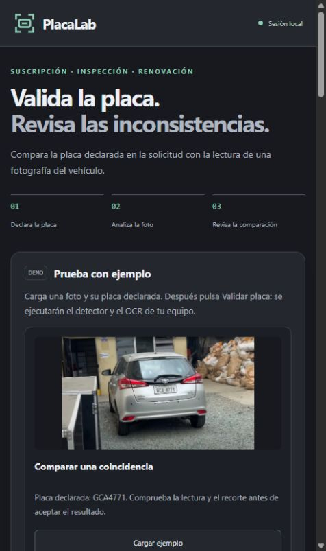
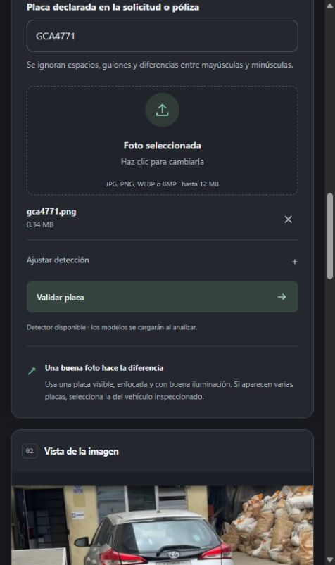
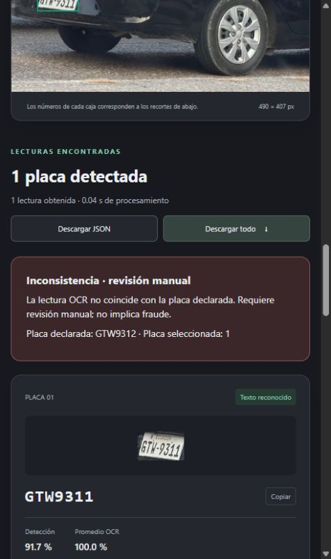
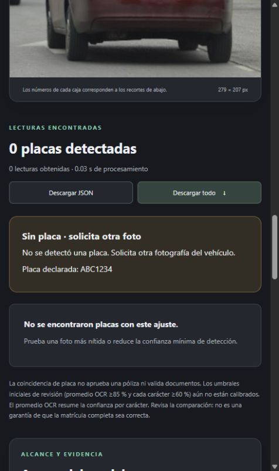

# Manual de usuario de PlacaLab

## Para qué sirve

PlacaLab compara una matrícula declarada con la lectura de una fotografía.
Muestra detecciones, recortes y advertencias para ayudar a revisar la evidencia.
Una coincidencia no aprueba pólizas ni verifica documentos o identidad completa.

Las capturas de este manual proceden de la aplicación real en un navegador
con ventana estrecha. El diseño se adapta al ancho disponible y puede distribuir
los paneles de otra forma en una ventana más amplia. Las anotaciones de cada
figura explican los controles y resultados visibles; no son salidas simuladas.

## 1. Abrir la aplicación

Si el servidor ya está iniciado, abrir `http://127.0.0.1:8080`.
Esta dirección funciona en el mismo equipo que ejecuta la aplicación.
Para acceso desde otro equipo, usar la URL HTTPS de la demo que entregue el
equipo junto con el usuario y contraseña exclusivos. El navegador solicitará
esas credenciales antes de mostrar la página. No son las credenciales de GitHub.
El enlace cambia al reiniciar el túnel y requiere la PC del equipo encendida.
Se probó el 21/10/2026; el 23/10 el túnel no estaba activo.

Para iniciarla desde PowerShell, en la raíz del proyecto y con el entorno
de pruebas ya instalado:

```powershell
.\.venv-tests\Scripts\python.exe web_app.py --device cpu --port 8080
```

Mantener abierta esa terminal. Para detener el servidor, pulsar Ctrl+C allí.
La preparación de un entorno nuevo se explica en [pruebas](pruebas.md);
las versiones probadas están en `requirements-tested.txt`.
Los pesos del detector deben estar en `models/best.pt` o indicarse con `--weights`.

Para reabrir la demo protegida, desde la raíz abrir dos terminales de PowerShell:

```powershell
.\.venv-tests\Scripts\python.exe tools/servidor_demo.py
```

```powershell
.\.model-cache\demo\cloudflared.exe tunnel --url http://127.0.0.1:8081 --protocol http2 --no-autoupdate
```

Mantener ambas terminales abiertas y compartir el nuevo enlace HTTPS. El usuario
y contraseña permanecen en el archivo local de acceso, excluido de Git.
Para cerrar la demo iniciada en segundo plano:

```powershell
powershell -NoProfile -File tools/cerrar_demo.ps1
```

La preparación de dependencias, credenciales y limitaciones se explica en
[demo temporal](demo_temporal.md). No incluir la contraseña en capturas o videos.



**Anotaciones de la figura 1:** la parte superior identifica la sesión local;
el bloque de tres pasos resume el recorrido. En “Prueba con ejemplo”, cada
tarjeta ofrece una fotografía y una matrícula declarada para cargar.

## 2. Probar sin preparar una fotografía

1. Buscar “Prueba con ejemplo”.
2. Elegir una tarjeta y pulsar “Cargar ejemplo”.
3. Revisar la matrícula que se completó en el formulario.
4. Pulsar “Validar placa”. Cargar el ejemplo por sí solo no ejecuta el modelo.
5. Esperar a que termine el procesamiento y revisar la comparación y el recorte.

| Ejemplo incluido | Placa declarada | Resultado observado en la comprobación |
|---|---|---|
| Comparar una coincidencia | GCA4771 | OCR GCA4771 y coincidencia |
| Explorar una inconsistencia | GTW9312 | OCR GTW9311 y revisión manual |
| Foto sin placa visible | ABC1234 | Sin detecciones; solicitar otra foto |

Son tres casos funcionales, no una garantía del resultado de cualquier imagen
ni una estimación de exactitud general.

## 3. Usar una fotografía propia

1. Escribir la matrícula declarada en la solicitud o póliza.
2. Arrastrar una foto al área de carga o hacer clic para seleccionarla.
3. Verificar el nombre del archivo y la vista previa.
4. Mantener inicialmente la confianza de detección en 60 %.
5. Pulsar “Validar placa” y esperar. La primera ejecución puede tardar más
   porque carga los modelos y, si hace falta, obtiene los pesos OCR.

Se admiten JPG, PNG, WEBP y BMP estáticos, hasta 12 MiB y 20 megapíxeles.
No se admiten vídeos o imágenes animadas. Usar fotos autorizadas, enfocadas
y sin compresión innecesaria.

La matrícula acepta letras y números, ignorando espacios, guiones y mayúsculas.
No se corrigen automáticamente O/0 o I/1. Aunque el formulario acepta entre
2 y 12 caracteres normalizados, el OCR utilizado tiene diez posiciones;
no se demuestra lectura fiable de formatos más largos.



**Anotaciones de la figura 2:** (1) el campo superior contiene la matrícula
declarada; (2) la zona de carga permite cambiar la foto y la × permite quitarla;
(3) “Ajustar detección” abre el control de confianza; (4) “Validar placa” inicia
el análisis. Debajo se muestra la vista previa.

## 4. Interpretar la comparación

| Resultado | Qué significa | Qué hacer |
|---|---|---|
| Coincidencia de placa | La lectura aceptada por las reglas coincide con la declarada | Comprobar recorte y vehículo; no implica aprobación |
| Inconsistencia · revisión manual | El texto leído difiere del declarado | Revisar la evidencia y la declaración; no afirmar fraude |
| Lectura dudosa o revisión manual | Lectura vacía, fallida, inválida o bajo las reglas de confianza | Revisar o solicitar una foto mejor |
| Selección pendiente | Hay varias placas detectadas | Elegir la del vehículo inspeccionado |
| Sin placa · solicita otra foto | El detector no encontró una placa con ese ajuste | Revisar la fotografía y solicitar otra si corresponde |


**Anotaciones de la figura 3:** (1) los botones superiores exportan el análisis;
(2) el panel verde muestra la comparación con GCA4771; (3) el recorte permite
contrastar la evidencia con la lectura; (4) detección y promedio OCR representan
confianzas distintas. Un valor redondeado a 100,0 % no garantiza exactitud.



**Anotaciones de la figura 4:** la declaración es GTW9312 y el texto reconocido
es GTW9311. El panel pide revisión manual y señala que la diferencia no implica
fraude. No modificar la declaración sólo para forzar una coincidencia.



**Anotaciones de la figura 5:** el contador informa cero detecciones, el panel
solicita otra fotografía y no se muestran recortes OCR. No detectar una placa
no prueba que el vehículo carezca de ella.

## 5. Revisar imagen, varias placas y confianzas

- “Original” y “Detección” alternan la imagen mostrada; las cajas numeradas
  corresponden a las tarjetas de recortes.
- Con varias detecciones, pulsar “Seleccionar este vehículo” en la tarjeta
  correcta. La aplicación no elige automáticamente la que coincide.
- Con una sola detección, la selección es automática; comprobar aun así que
  pertenece al vehículo de interés y no a uno del fondo.
- “Ver confianza por carácter” muestra el detalle de la lectura. Las reglas
  iniciales exigen media ≥85 % y cada carácter ≥60 %, pero no están calibradas.
- “Ajustar detección” permite variar el mínimo entre 10 % y 95 %. Bajar el
  valor puede aumentar tanto detecciones como falsos positivos. Cambiarlo no
  mejora automáticamente el OCR ni demuestra un umbral óptimo.
- Si se cambia la matrícula declarada, volver a analizar para actualizar la
  comparación; no interpretar el resultado anterior como si fuera de la nueva.

## 6. Exportar y conservar resultados

- “Descargar JSON”: datos estructurados del análisis y comparación.
- “Descargar todo”: ZIP con imagen anotada, recortes y `resultados.json`.
- “Descargar recorte”: imagen de una placa concreta.
- “Copiar matrícula”: copia el texto reconocido para revisión o registro.

Cuando se selecciona una placa entre varias, el servidor actualiza la comparación
y el ZIP. Exportar después de seleccionar y revisar el resultado.
Las descargas pueden contener matrículas y fotos: conservarlas dentro del uso
autorizado. El servidor no elimina copias que el usuario guarde en su equipo.

## 7. Métricas y recomendaciones

“Acerca del modelo” explica el pipeline, métricas, limitaciones y uso responsable.
“Calidad de imagen y recomendaciones” sugiere mejorar enfoque, iluminación,
tamaño y ángulo de la placa. Aumentar artificialmente una foto borrosa no
recupera detalles inexistentes.

Las métricas del detector y del OCR son diferentes. El 77,27 % OCR corresponde
a 17 de 22 recortes legibles de una muestra concreta, no a todo el sistema.
Véanse [evaluación OCR](../results/evaluation/analisis_ocr.md) y
[análisis de datos](analisis_datos.md).

## 8. Problemas comunes

| Problema | Comprobación y solución |
|---|---|
| El navegador no conecta | Iniciar el servidor y usar el puerto indicado en la terminal |
| El puerto 8080 está ocupado | Iniciar con `--port 8081` y abrir esa dirección |
| El entorno `.venv` no arranca | Usar `.venv-tests/`, el entorno verificado de esta entrega |
| “Validar placa” está deshabilitado | Cargar una fotografía y comprobar la matrícula declarada |
| Archivo rechazado | Revisar formato, tamaño, resolución y que no esté dañado o animado |
| No se encuentra el modelo | Comprobar `models/best.pt` o iniciar con `--weights "ruta/al/best.pt"` |
| No se cargan los modelos | Revisar la terminal, dependencias, acceso a caché y conexión inicial OCR |
| CUDA no disponible | Iniciar con `--device cpu`, probado en este proyecto |
| No hay detecciones | Revisar si la placa es visible; probar otra foto y evaluar el ajuste de detección |
| El OCR falla o parece incorrecto | Revisar el recorte; no adivinar caracteres y solicitar otra foto |
| El análisis expiró al seleccionar | Volver a analizar y seleccionar antes de exportar |
| No funciona copiar | Seleccionar/copiar el texto manualmente o exportar JSON |
| Se ve un estilo anterior | Recargar con Ctrl+F5 |
| El enlace público no abre | Confirmar que servidor y túnel estén activos y pedir el enlace vigente |
| Pide usuario y contraseña | Usar las credenciales de la demo proporcionadas por el equipo |
| Aparece un límite temporal (429) | Esperar; la demo admite seis análisis por minuto y una inferencia a la vez |

## 9. Preguntas frecuentes

**¿Una coincidencia confirma el vehículo o aprueba una póliza?**
No. Confirma una igualdad de texto bajo las reglas del prototipo.

**¿Puedo usar imágenes desde otro equipo con la dirección 127.0.0.1?**
Esa dirección identifica el propio equipo. Para otra red se usa la URL HTTPS
del túnel activo, con contraseña. El enlace temporal no funciona si la PC está
apagada, suspendida o el túnel se ha cerrado.

**¿Por qué el primer análisis tarda más?**
Carga los modelos y puede obtener los pesos OCR. Los siguientes reutilizan
los modelos mientras el proceso permanezca activo.

**¿Las fotos se guardan?**
No se archivan las fotos subidas. Puede haber archivos temporales durante la
transferencia; se conservan hasta cuatro resultados en memoria por proceso.
En modo local se limpian al recibir solicitudes; la demo añade una revisión
cada 30 segundos para descartar resultados de más de quince minutos.
Las exportaciones descargadas y los ejemplos incluidos sí persisten.

**¿Por qué una confianza alta puede acompañar una lectura errónea?**
La confianza no está calibrada como probabilidad de placa correcta. Revisar
siempre el texto, la imagen y el contexto.

## 10. Soporte

Durante la entrega, comunicar los problemas al equipo de desarrollo:
Daniel Guevara (Scrum Master) y Christian Guerra (Product Owner).
El medio de coordinación y contacto del equipo es WhatsApp. Utilizar el contacto
ya acordado con sus integrantes; no se publican números ni enlaces de grupo
que no se hayan proporcionado para ese fin. También se pueden comunicar
incidencias técnicas sin datos sensibles mediante
[Issues del repositorio](https://github.com/DanielGuevara25/Placas_OCR_ProyectoFinal/issues).

Para reportar un fallo, indicar versión del proyecto, acción realizada y mensaje
visible. Evitar adjuntar fotografías, matrículas o información del sistema laboral
fuera del alcance autorizado. El responsable puede consultar la terminal local.
