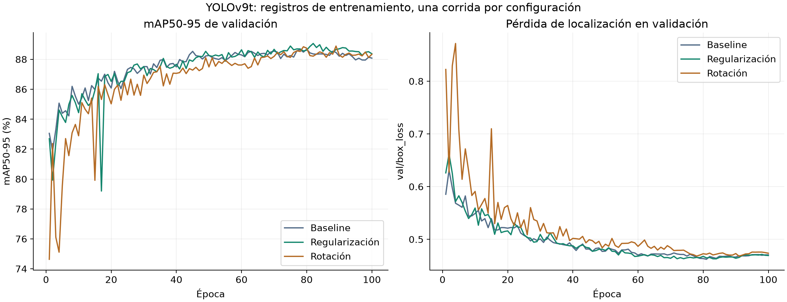
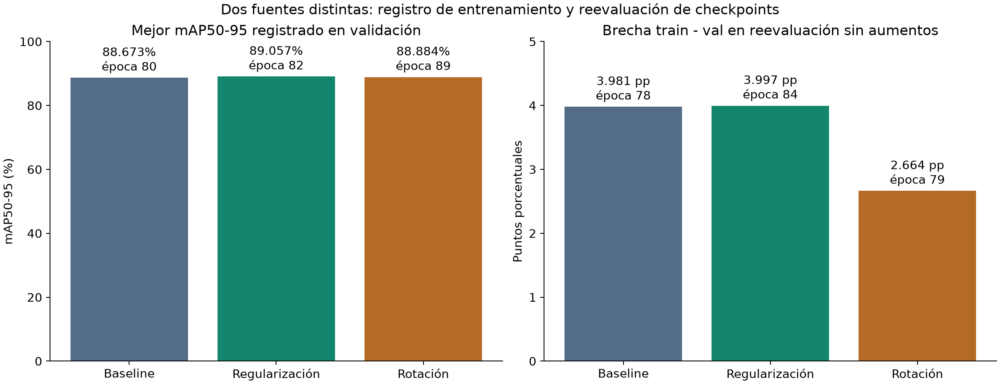

# Optimización del detector YOLOv9t

**Actualización 21/10/2026:** este documento conserva la comparación histórica
de tres corridas. El estudio ampliado posterior sí ejecutó Optuna, importancia,
PDP y robustez; consultar `resultados_semana5.md` y `estudio_semana5.md`.
Las carencias descritas en este análisis corresponden a la evidencia previa.

## Objetivo y alcance

Se compararon tres configuraciones del detector de placas para seleccionar
la de mayor mAP50-95 de validación. Este documento analiza los archivos históricos
del proyecto; no representa nuevos entrenamientos ni una reevaluación ejecutada
durante la preparación de la entrega.

El OCR se mantuvo separado: estos experimentos optimizan detección de cajas,
no exactitud de lectura ni decisiones de aseguramiento.

## Configuraciones y controles

Los tres archivos `args.yaml` registran 100 épocas, imágenes de 640 píxeles,
batch 16, semilla 42, `deterministic=true`, dispositivo GPU 0, `optimizer=auto`
y ausencia de volteos horizontales o verticales. No se debe interpretar `lr0`
como prueba de la tasa efectiva cuando el optimizador se configura en automático.

| Experimento | weight_decay | degrees | Cambio frente al baseline |
|---|---:|---:|---|
| Baseline | 0,0005 | 0 | Configuración de referencia |
| Regularización | 0,001 | 0 | Duplicar weight_decay |
| Rotación | 0,0005 | 5 | Activar aumento de rotación con magnitud 5 grados |

La comparación automatizada confirmó que, descontando rutas del modelo y nombres
de salida, únicamente cambian `weight_decay` o `degrees`, respectivamente.
El script `src/entrenar_mejoras.py` inicia cada variante desde el peso base
`yolov9t.pt`. El registro de argumentos por sí solo no demuestra igualdad binaria
del peso inicial ni independencia del dataset; esas comprobaciones son adicionales.

Se dispone de una sola corrida por configuración. No se realizaron una búsqueda
exhaustiva, múltiples semillas ni una estimación de incertidumbre entre corridas.

## Resultados del registro de entrenamiento

Para cada experimento se selecciona la fila de mayor `metrics/mAP50-95(B)`
en su propio `results.csv`. Precisión, recall y mAP50 se toman de esa misma fila.
Todas las métricas de esta tabla corresponden a validación.

| Experimento | Mejor época | Precisión (%) | Recall (%) | mAP50 (%) | mAP50-95 (%) | Mejora vs. baseline (pp) |
|---|---:|---:|---:|---:|---:|---:|
| Baseline | 80 | 97,499 | 97,314 | 98,289 | 88,673 | 0,000 |
| Regularización | 82 | 97,822 | 96,825 | 98,242 | 89,057 | +0,384 |
| Rotación | 89 | 97,440 | 96,825 | 99,087 | 88,884 | +0,211 |

La regularización tiene el mayor mAP50-95 entre las corridas disponibles.
La rotación tiene mayor mAP50, pero no mayor mAP50-95. Elegir una métrica
principal explícita evita seleccionar cada modelo por una métrica distinta.

La regularización mejora mAP50-95 en 0,384 puntos porcentuales frente al baseline,
con una reducción de recall de 0,489 puntos en las filas seleccionadas. La mejora
es modesta y no permite afirmar significancia estadística ni superioridad universal.

Al finalizar las 100 épocas, el mAP50-95 es 88,078 %, 88,368 % y 88,336 %,
respectivamente. El mejor valor aparece antes del final en las tres corridas:
la última época no es automáticamente la mejor.

Los tiempos acumulados registrados fueron aproximadamente 87,19, 73,05 y 94,36
minutos. No son un benchmark controlado de velocidad; pueden depender del estado
del equipo y de condiciones de ejecución no documentadas.



## Reevaluación de checkpoints y brecha train/val

El archivo `results/overfitting/metricas_por_epoca.csv` contiene 600 filas:
tres experimentos, cien épocas y dos particiones. Se verificaron continuidad
de épocas, métricas finitas dentro de [0,1] y coincidencia de hashes entre
train y val para cada checkpoint.

El manifiesto histórico registra Ultralytics 8.4.171, PyTorch 2.7.1+cu128,
`augment=false`, `rect=true`, confianza 0,001 e IoU NMS 0,7. Estos valores
describen esa evaluación; no son una recomendación de confianza para la web.

En esta tabla se selecciona la mejor época según la reevaluación de validación
y se toma train de esa misma época y checkpoint:

| Experimento | Época reevaluada | mAP50-95 train (%) | mAP50-95 val (%) | Brecha train-val (pp) |
|---|---:|---:|---:|---:|
| Baseline | 78 | 92,680 | 88,699 | 3,981 |
| Regularización | 84 | 93,014 | 89,017 | 3,997 |
| Rotación | 79 | 91,546 | 88,882 | 2,664 |

Las épocas difieren de las del registro de entrenamiento. Son dos fuentes
de medición y no se intercambian para atribuir métricas a un checkpoint.
No se ha aislado experimentalmente la causa de esas diferencias; no se deben
explicar por un factor concreto sin verificarlo.

La rotación presenta la menor brecha en las épocas seleccionadas, pero menor
mAP50-95 de validación que la regularización. La regularización no demuestra
una reducción de la brecha frente al baseline en esta comparación.
Una brecha positiva describe diferencias de rendimiento entre particiones;
por sí sola no prueba un sobreajuste grave ni ausencia de contaminación de datos.



## Selección y evaluación final separada

Los resultados disponibles respaldan mantener el experimento de regularización
como detector de la web por su mayor mAP50-95 de validación. La aplicación usa
`models/best.pt`; su origen y SHA256 constan en `models/manifest.json`.
No se ha identificado aquí la época exacta de ese archivo mediante una
comparación de sus tensores con cada checkpoint histórico.

El archivo `results/evaluation/detector_test.json` documenta una evaluación
aportada previamente sobre test: 734 imágenes, 819 instancias, precisión
98,6384 %, recall 97,9243 %, mAP50 99,4150 % y mAP50-95 89,3450 %.
El registro original no contiene hash de checkpoint, por lo que no debe
atribuirse retrospectivamente el hash actual a aquella ejecución sin evidencia.

Ese test se reporta como evaluación final y no se usa para escoger
hiperparámetros. No hay resultados de test equivalentes de las otras dos
configuraciones que permitan afirmar una mejora frente al baseline en test.
Todavía debe confirmarse la independencia entre particiones.

## Sensibilidad y requisitos del Workshop S5

Lo realizado es una comparación local de cambios individuales:

- `weight_decay`: valores observados 0,0005 y 0,001, con `degrees=0`.
- `degrees`: valores observados 0 y 5, con `weight_decay=0,0005`.

La mejora observada en mAP50-95 es +0,384 pp para regularización y +0,211 pp
para rotación. Este orden describe las dos intervenciones ensayadas; no es
un ranking de importancia global de hiperparámetros.

La directriz solicita dependencia parcial, ranking de importancia e interacciones.
No se encontró evidencia suficiente de estos análisis en los archivos revisados.
Tres configuraciones, sin la combinación `weight_decay=0,001` con `degrees=5`,
no permiten estimar esa interacción; tampoco sustentan curvas de dependencia
parcial fiables. Las 100 épocas son checkpoints de cada corrida, no cien
configuraciones independientes de hiperparámetros.

Para ampliar este apartado sería necesario un diseño experimental documentado
con más configuraciones, combinaciones y semillas, usando validación para
selección y reservando test. No se han inventado gráficos ni ejecutado nuevos
entrenamientos para simular el cumplimiento de esos requisitos.

## Reproducción del análisis

Desde la raíz, con el entorno probado:

```powershell
.\.venv-tests\Scripts\python.exe -m src.comparar_experimentos
```

El comando vuelve a leer los registros, valida su estructura y genera:

- `results/metrics/comparacion_experimentos.csv` y `.json`.
- `results/figures/comparacion_entrenamiento.png`.
- `results/figures/comparacion_modelos.png`.

El JSON registra hashes SHA256 de las fuentes analizadas. Los archivos
históricos permanecen sin modificación. La ejecución no carga pesos,
no entrena y no necesita GPU.
